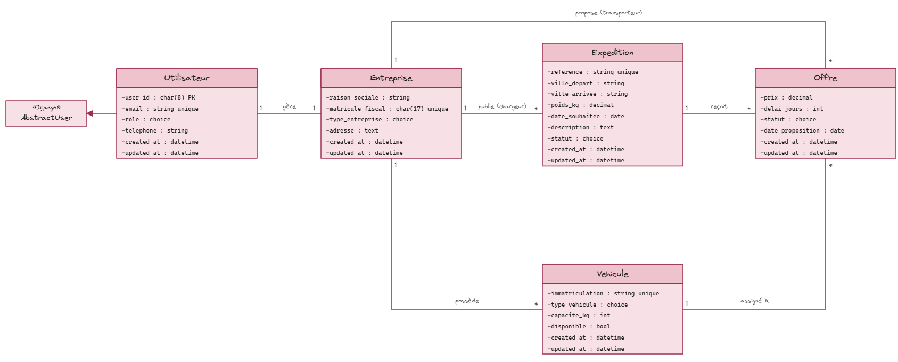
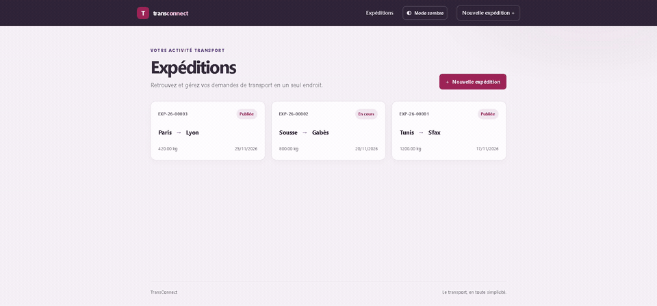

# PY-WEB

use vscode exaclidraw extension to see this...

## TransConnect

Run the Django project with `uv run python manage.py runserver`. The admin includes
an integrity dashboard at `/admin/health-check/`; expedition pages are available at
`/lister/`.

To create sample companies, vehicles, expeditions, and offers, run
`uv run python manage.py seed_demo`. Demo users have no usable password. Re-running
the command requires `--reset`, which deletes the existing demo accounts and their
related data before recreating them.

Use the **Gestion** menu to manage companies, vehicles, and offers. These pages
require an authenticated account; manage user accounts through Django admin.
Deleting a company also deletes its related vehicles, expeditions, and offers.
Vehicles linked to offers and accepted offers are protected from editing or deletion.

### Five-second demo

[Download the MP4](media/transconnect-demo.mp4).
